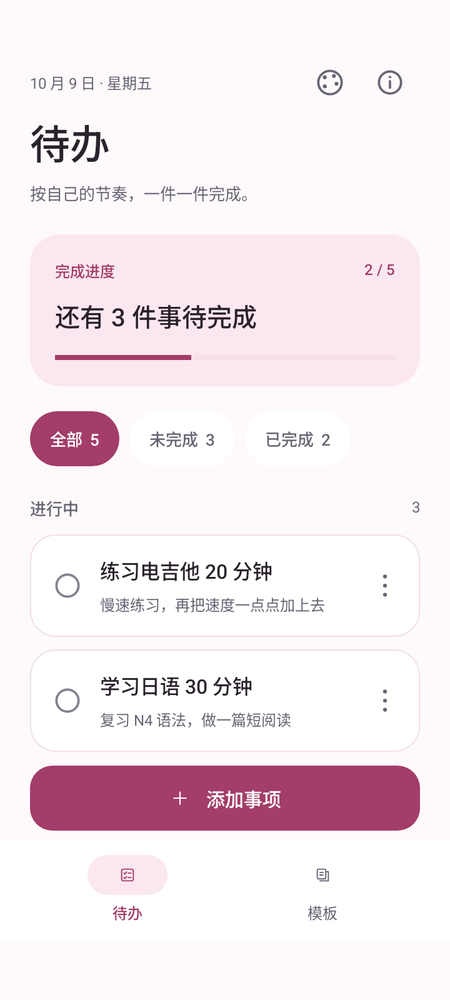
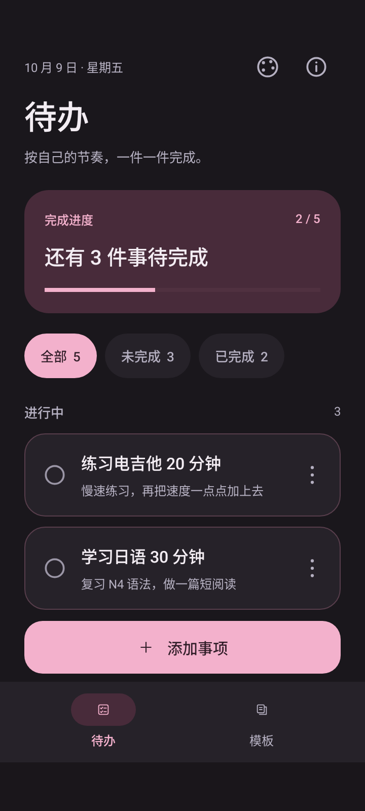
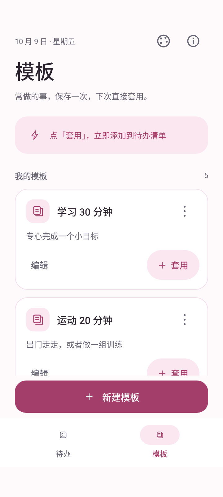

# 轻待办 · QingTodo

把想做的事记下来，把常做的事存成模板。

软件由GPT6.1-sol生成

轻待办是一款轻量、离线的待办清单APP，适合管理日常小事、学习计划和重复执行的清单。无需注册，数据保存在手机本地。

**当前版本：1.3.0 · Android 8.0 及以上 · 安装包约 53 KiB**

[下载安装包](downloads/qingtodo-v1.3.0.apk) · [使用说明](docs/usage.md) · [更新记录](CHANGELOG.md) · [构建与测试](docs/development.md) · [隐私说明](docs/privacy.md)

## 界面预览

  
  
  

截图中的事项为测试示例；首次运行时待办列表为空，提供三个可编辑或删除的示例模板。

## 能做什么

| 功能 | 使用方式 |
| --- | --- |
| 记录事项 | 添加标题和可选备注，随时编辑 |
| 跟踪完成情况 | 点击事项切换完成状态，查看完成进度 |
| 筛选清单 | 切换全部、未完成、已完成 |
| 重复套用模板 | 将常做的事保存为模板，每次套用生成独立的未完成事项 |
| 整理已完成事项 | 一键批量清除，提示期间可撤销 |
| 删除撤销 | 删除事项或模板后，通常有 10 秒撤销窗口 |
| 调整外观 | 8 种配色，明暗模式跟随系统，选择自动保存 |

当前版本不提供账号、云同步、定时提醒、桌面小组件或导入导出。模板需要手动套用，不会定时生成任务。

## 下载与安装

在 Android 手机中打开上方下载安装包链接，选择下载原始文件，再允许浏览器或文件管理器安装应用。

- 包名：`com.qingtodo.app`
- 版本：`1.3.0`，版本代码：`4`
- 最低系统：Android 8.0（API 26）
- 安装包大小：53,958 字节
- SHA-256：`d167b107c383dbe037c997f3b5354b5df49c8f0c5b47a63c662caeb6fc693608`

同一签名的新版可覆盖安装并保留数据。卸载或清除应用数据会删除清单和模板，当前没有导出功能。

## 本地存储与隐私

应用使用 SQLite 保存事项和模板，主题设置使用 SharedPreferences。Manifest 未声明任何权限，包括网络权限；应用关闭 Android 自动备份。不需要登录，界面与数据处理均在设备本地完成。详情见[隐私说明](docs/privacy.md)。

## 开发与验证

采用 Java、Android 原生控件和 SQLite，没有 WebView 或第三方运行时依赖。入口是 `MainActivity.java`，存储层为 `TodoStore.java`，配色在 `ColorTheme.java` 中。

Android Studio 可打开本目录；配置 JDK 17、Android SDK Platform 36，使用 AGP 8.10.1 和 Gradle 8.11.1。详细命令、签名与设备验收流程见[开发说明](docs/development.md)。发布仓库不包含私有签名密钥。

原始包附带 2026-10-09 在 Android 16 模拟器上的 125 项检查记录，包含大字体、主题、撤销和升级检查，见 `tests/results-1.3.0/`。这些是随附历史结果，本次整理未重新运行 Android 设备测试。提供的 APK 哈希已与元数据核对一致。

## 源码许可

原始源码包未附开源许可证，本次整理未替作者指定许可证。源码可查看；复制、修改及再分发的授权范围需由权利人明确。
